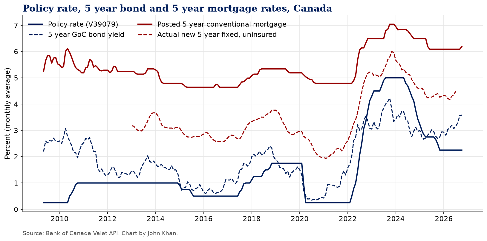
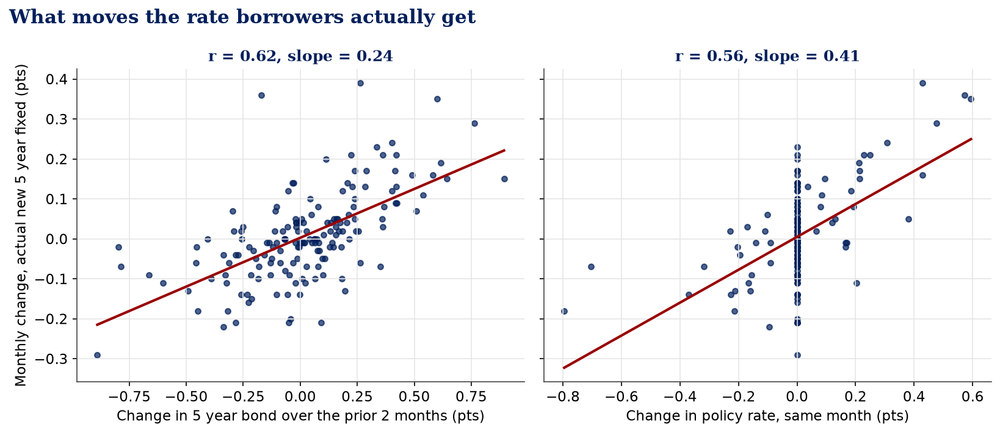
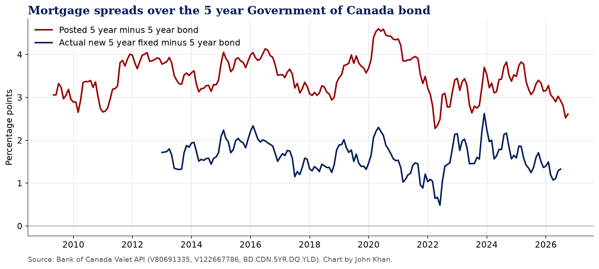

# Who Sets Canada's 5 Year Mortgage Rate?

By John Khan

**Kaggle notebook:** coming soon <!-- KAGGLE_URL -->

## Question

Does Canada's five year fixed mortgage rate follow the Bank of Canada policy rate or the five year Government of Canada bond yield, and how far above the bond do posted and actual mortgage rates sit?

## Data sources

* Bank of Canada Valet API, https://www.bankofcanada.ca/valet/docs
* `V39079` target for the overnight rate
* `BD.CDN.5YR.DQ.YLD` 5 year Government of Canada benchmark bond yield
* `V80691335` posted 5 year conventional mortgage rate
* `V122667786` rate on new uninsured fixed 5 years and over mortgages, chartered banks

The notebook pulls everything live from the Bank of Canada Valet API. A snapshot of the data from the last run is in `data/`, and the notebook falls back to it if the API is unreachable.

## Findings

*Figures below are from the run on October 18, 2026, with daily data through October 15, 2026 and actual lending rates through July 2026.*

**1. The bond market explains more of the five year fixed rate than the Bank of Canada does, but it shows up with a delay.** On month to month changes, the five year bond yield alone (this month plus the two before) explains 39% of the movement in the rate borrowers actually got on new uninsured five year fixed loans. The policy rate alone explains 33%. Together they explain 50%. For the posted rate the gap is wider: 25% for the bond against 9% for the policy rate. The strongest bond link comes one to two months later (correlation 0.48 and 0.51), which fits how rate holds work.

**2. Right now is a clean example.** The policy rate has sat at 2.25% since October 30, 2025. Over the same stretch the five year bond went from a monthly average low of 2.75% in November 2025 to 3.58% in October 2026. The actual new five year fixed rate rose from 4.17% in April 2026 to 4.49% in July 2026, and the posted rate moved from 6.09% to 6.19%. Nothing changed at the Bank of Canada, and five year mortgages still got more expensive.

**3. The posted rate is a poor guide to what people pay.** Since 2013 the posted five year rate has averaged 1.89 points above the actual rate on new uninsured five year fixed loans. In July 2026 the gap was 1.60 points (6.09% posted against 4.49% actual).

**4. Banks price five year fixed loans at about 1.6 points over the bond.** The actual rate averaged 1.62 points above the five year bond since 2013. It was 1.33 points in July 2026, below that average. The spread ranged from 0.48 points (June 2022, when bond yields jumped faster than loan rates) to 2.62 points (December 2023, when bond yields fell faster than loan rates).

**What this means for a borrower.** If you are shopping for a five year fixed rate, watch the five year Government of Canada bond, not the next rate announcement. A sustained move in the bond tends to reach lender rate sheets within one to two months.


## Charts





## Run it

```
pip install -r requirements.txt
jupyter nbconvert --to notebook --execute canada-policy-rate-bond-yield-mortgage-rate.ipynb
```

On Kaggle, keep Internet on in the notebook settings, or upload the CSVs in `data/` as a dataset.

## License

Code is MIT licensed. Data belongs to its publishers and is used under their terms (Bank of Canada: https://www.bankofcanada.ca/terms/, Statistics Canada Open Licence: https://www.statcan.gc.ca/en/terms-conditions/open-licence).
